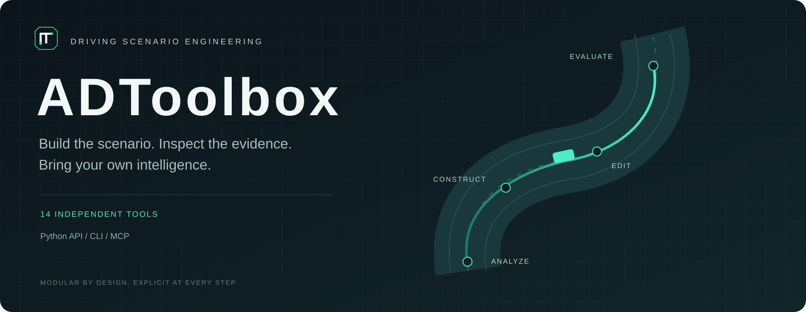

<div align="center">



**Independent tools for driving scenario engineering.**

[English](README.md) · [简体中文](README.zh-CN.md) · [Tool reference](docs/tools/README.md) · [Examples](examples/README.md)

[](https://github.com/Max-luo-song/tool_box/actions/workflows/ci.yml)

[](LICENSE)

</div>

TOOLBOX brings failure evidence, scenario design, video retrieval, dynamic reconstruction, editing and policy evaluation behind a consistent interface. Use one tool from Python, call it from a terminal, or expose it to an MCP client. Each call has explicit inputs and inspectable outputs.

The library includes **14 independent tools**. Heavy compute engines are optional installs; orchestration and next-step selection belong to your own application.

### Start in one minute

```bash
git clone https://github.com/Max-luo-song/tool_box.git
cd tool_box
python -m venv .venv
source .venv/bin/activate
python -m pip install -e .

tool-box list
tool-box run edit_config_generator --input examples/edit_config_generator/input.json
tool-box run failure_case_filter --input examples/failure_case_filter/input.json
```

These examples compile a real edit document and screen synthetic box geometry. They need **no API key, GPU or model download**. The curation example also writes a local JSONL case entry. External-data examples use explicit path templates.

```python
from driving_toolbox.tools.edit_config_generator import run

result = run({
    "coordinate_system": "camera_local_meters",
    "operations": [{"operation": "remove", "instance_id": 0}],
})
assert result["status"] == "success"
print(result["result"]["edit_config"])
```

### The tool collection

| Tool | Capability | Runtime |
|---|---|---|
| [`failure_analyzer`](docs/tools/failure_analyzer.md) | Failure evidence analysis | llm |
| [`scene_requirement_generator`](docs/tools/scene_requirement_generator.md) | Scenario requirements | llm |
| [`scene_conceiver`](docs/tools/scene_conceiver.md) | Scenario conception | llm |
| [`video_retriever`](docs/tools/video_retriever.md) | Driving video retrieval | native + optional backend |
| [`instance_discovery`](docs/tools/instance_discovery.md) | Traffic instance tracking | optional vision / backend |
| [`reconstruction`](docs/tools/reconstruction.md) | Dynamic scene reconstruction | optional backend |
| [`edit_plan_builder`](docs/tools/edit_plan_builder.md) | Scene edit planning | llm |
| [`edit_config_generator`](docs/tools/edit_config_generator.md) | Edit configuration compiler | native + llm |
| [`scene_editor`](docs/tools/scene_editor.md) | Scene editing and rendering | optional backend |
| [`scene_validator`](docs/tools/scene_validator.md) | Scene consistency checks | native + optional llm |
| [`recovery_advisor`](docs/tools/recovery_advisor.md) | Execution diagnostics | native |
| [`policy_runner`](docs/tools/policy_runner.md) | Closed-loop policy evaluation | optional backend |
| [`failure_case_filter`](docs/tools/failure_case_filter.md) | Failure case curation | native |
| [`policy_trainer`](docs/tools/policy_trainer.md) | Supervised policy fine-tuning | optional backend |

**Native** tools run with the base package. **LLM** tools require your configured model endpoint. **Optional backend** tools require a separately installed engine, weights and data. Native video retrieval ranks supplied captions; semantic video search is a separate backend integration.

### Designed to be composed

- **One contract.** Versioned JSON results, typed inputs, explicit artifacts and useful errors.
- **Independent environments.** Reconstruction, tracking, simulation and training can use separate runtimes.
- **Portable scene edits.** Trajectory, rotation, scale, removal, addition and replacement share one functional interface.
- **Evidence with limits.** Visual plausibility, geometric screening and official policy metrics remain distinguishable.

### Bring your own compute

Configure only what you use. Start with [runtime configuration](docs/configuration.md), then choose an [optional backend profile](docs/backends/README.md). Existing integrations can use the [JSON subprocess bridge](docs/configuration.md#external-json-backend).

For model tools, export `TOOLBOX_API_KEY`, `TOOLBOX_BASE_URL` and `TOOLBOX_MODEL`. Text evidence and explicitly attached frames are sent to that endpoint. The library does not automatically load `.env` files.

```bash
python -m pip install -e '.[mcp]'
tool-box doctor --config configs/runtime.local.json
tool-box-mcp --config configs/runtime.local.json
```

See [MCP setup](docs/mcp.md), [coordinate and data contracts](docs/contracts.md), and [per-tool examples](examples/README.md).

### Release scope

This is an **alpha toolkit release**. Portable implementations, model transport and process/protocol contracts are covered by tests. Clean GPU reconstruction, edited-scene fidelity, closed-loop metrics and policy training have not yet been reproduced for this standalone distribution. [Validation status](docs/validation.md) records the distinction.

Box-overlap screening does not establish collision responsibility or road compliance. Sampled-frame review does not certify physics. Fine-tuning requires valid labels; a mined failure is not automatically a training example.

### Contribute

See [contributing](CONTRIBUTING.md) and [security](SECURITY.md). Useful next steps are reproducible backend profiles, measured editing examples and additional portable scene adapters.

### License and acknowledgments

Standalone toolkit code is licensed under [Apache-2.0](LICENSE). Optional engines and the supplied reconstruction extension patch retain applicable upstream terms and attribution. See [NOTICE](NOTICE), [third-party notices](THIRD_PARTY_NOTICES.md) and the backend guides. Model weights and datasets are not distributed.
