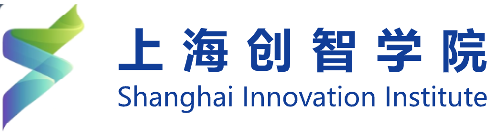

<div align="center">


**面向自动驾驶场景工程的独立工具集。**

[English](README.md) · [简体中文](README.zh-CN.md) · [工具说明](docs/tools/README.md) · [示例](examples/README.md)

[](https://github.com/Max-luo-song/tool_box/actions/workflows/ci.yml)

[](LICENSE)

</div>

ADToolbox 将失败证据分析、场景设计、视频检索、动态三维重建、编辑与策略评测统一为可独立调用的工具。你可以从 Python 调用一个工具，通过终端运行，或接入 MCP 客户端。每次调用都明确接收输入、返回可检查的结果。

工具集包含 **14 个有真实实现支撑的独立工具**，重型计算引擎随仓库提供：带编辑扩展的动态高斯重建引擎、闭环仿真引擎和策略训练栈都在 [`projects/`](projects/README.md) 下。流程编排与下一步决策由调用方自己的应用负责——ADToolbox 刻意不包含 Agent 框架。

### 一分钟开始

```bash
git clone https://github.com/Max-luo-song/tool_box.git
cd tool_box
python -m venv .venv
source .venv/bin/activate
python -m pip install -e .

adtoolbox list
adtoolbox run edit_config_generator --input examples/edit_config_generator/input.json
adtoolbox run failure_case_filter --input examples/failure_case_filter/input.json
```

这两个示例会实际编译编辑配置、筛选合成车辆框，并将筛选案例写入本地 JSONL。**无需 API 密钥、GPU 或下载模型**。合成几何示例不代表仿真测评；依赖外部数据的示例使用明确的路径模板。

```python
from adtoolbox.tools.edit_config_generator import run

result = run({
    "coordinate_system": "camera_local_meters",
    "operations": [{"operation": "remove", "instance_id": 0}],
})
assert result["status"] == "success"
print(result["result"]["edit_config"])
```

### 完整工具集

| 工具 | 功能 | 运行条件 |
|---|---|---|
| [`failure_analyzer`](docs/tools/failure_analyzer.md) | 失败证据分析 | llm |
| [`scene_requirement_generator`](docs/tools/scene_requirement_generator.md) | 场景需求生成 | llm |
| [`scene_conceiver`](docs/tools/scene_conceiver.md) | 场景方案设计 | llm |
| [`video_retriever`](docs/tools/video_retriever.md) | 驾驶视频检索 | native + engine |
| [`instance_discovery`](docs/tools/instance_discovery.md) | 交通实例跟踪 | optional vision / engine |
| [`reconstruction`](docs/tools/reconstruction.md) | 动态场景重建 | bundled engine |
| [`edit_plan_builder`](docs/tools/edit_plan_builder.md) | 场景编辑计划 | llm |
| [`edit_config_generator`](docs/tools/edit_config_generator.md) | 编辑配置编译 | native + llm |
| [`scene_editor`](docs/tools/scene_editor.md) | 场景编辑与渲染 | bundled engine |
| [`scene_validator`](docs/tools/scene_validator.md) | 场景一致性检查 | native + optional llm |
| [`recovery_advisor`](docs/tools/recovery_advisor.md) | 执行诊断建议 | native |
| [`policy_runner`](docs/tools/policy_runner.md) | 闭环策略运行 | bundled engine |
| [`failure_case_filter`](docs/tools/failure_case_filter.md) | 失败案例筛选 | native |
| [`policy_trainer`](docs/tools/policy_trainer.md) | 策略监督微调 | bundled engine |

**native** 表示基础安装可运行；**llm** 需要自行配置模型接口；**bundled engine** 表示驱动 `projects/` 下随仓库提供的真实引擎源码，你仍需准备该引擎的 Python 环境、模型权重和数据。原生视频检索基于用户提供的字幕与标签；`projects/video_search` 提供完整的语义建库与检索流水线。

### 为独立组合而设计

- **统一协议**：版本化 JSON 结果、明确的输入、产物与错误。
- **环境隔离**：重建、跟踪、仿真和训练可以使用不同 Python 环境。
- **可移植编辑配置**：支持轨迹、旋转、缩放、删除、添加与替换。
- **保留证据边界**：视觉合理性、几何筛选与官方策略指标分别表达。

### 准备计算引擎

只配置你需要的能力。先阅读[运行配置](docs/configuration.md)，再查阅[引擎指南](docs/backends/README.md)。验证内嵌引擎树的完整性并查看安装清单：

```bash
python scripts/setup_project.py reconstruction
python scripts/setup_project.py simulation
```

编辑后的重建结果可通过 `scripts/convert_scene.py` 转换为仿真场景；仿真运行结果可通过 `projects/simulation/scripts/export_policy_training_data.py` 导出为监督微调数据。已有服务也可通过 [JSON 子进程协议](docs/configuration.md#external-json-backend)接入。

模型工具使用 `ADTOOLBOX_API_KEY`、`ADTOOLBOX_BASE_URL`、`ADTOOLBOX_MODEL`。提供的文本证据及明确附加的图像会发送到该接口。工具库不会自动加载 `.env`。

```bash
python -m pip install -e '.[mcp]'
adtoolbox doctor --config configs/runtime.local.json
adtoolbox-mcp --config configs/runtime.local.json
```

另见 [MCP 接入](docs/mcp.md)、[坐标与数据协议](docs/contracts.md)及[单工具示例](examples/README.md)。

### 当前版本范围

这是一个 **Alpha 工具集版本**。测试覆盖可移植实现、模型请求传输与子进程/MCP 协议。内嵌引擎已完成源码完整性与接线验证；干净环境的 GPU 重建效果、编辑保真度、闭环指标和训练收益取决于你的硬件、权重与数据，详见[验证状态](docs/validation.md)。

车辆框重叠筛选不等同于碰撞责任或道路合规评分；抽帧视觉检查不证明物理正确；失败案例也不自动构成有效训练标注。

### 团队介绍

ADToolbox 由来自华东师范大学与上海创智学院的团队共同建设。

<table align="center">
  <tr>
    <td align="center" width="50%">
      
      <br />华东师范大学
    </td>
    <td align="center" width="50%">
      
      <br />上海创智学院
    </td>
  </tr>
</table>

<p align="center">
  Luosong Guo · Haochun Gao · Xiang Yang · Dinghao LIn · Yi Luo<br />
  Zhenyu Hou · Ao Gao · Chaoyang Li · Jingyu Gong <sup>Project Leader</sup> · Yuan Xie <sup>Project Leader</sup>
</p>

### 参与贡献

参见[贡献指南](CONTRIBUTING.md)和[安全说明](SECURITY.md)。后续重点是可复现的引擎配置、经过测量的场景编辑案例和更多可移植格式适配。

### 许可与致谢

由 [Max-luo-song](https://github.com/Max-luo-song) 主导，AI 编程助手 **Codex** 参与代码实现、文档与视觉资产制作。参见[贡献者名单](CONTRIBUTORS.md)。

独立工具库代码采用 [Apache-2.0](LICENSE)。`projects/` 下的内嵌引擎源自 Apache-2.0 上游项目，保留原始许可与归属，详见 [NOTICE](NOTICE)、[第三方声明](THIRD_PARTY_NOTICES.md)及引擎文档。模型权重与数据集不随库发布。
